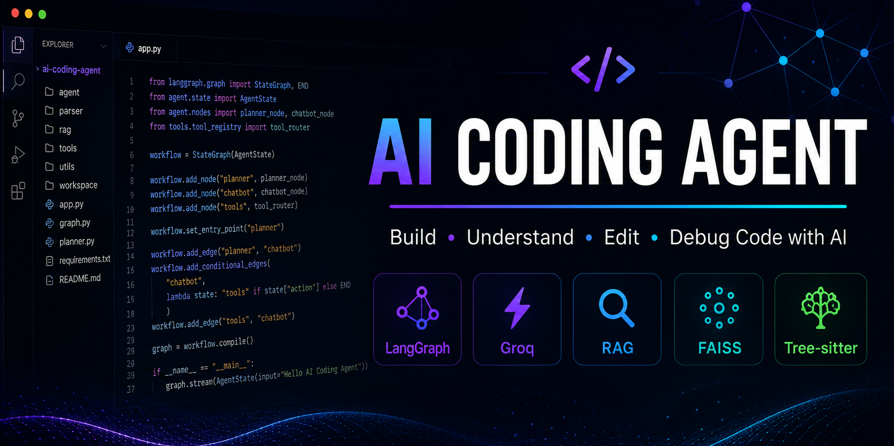
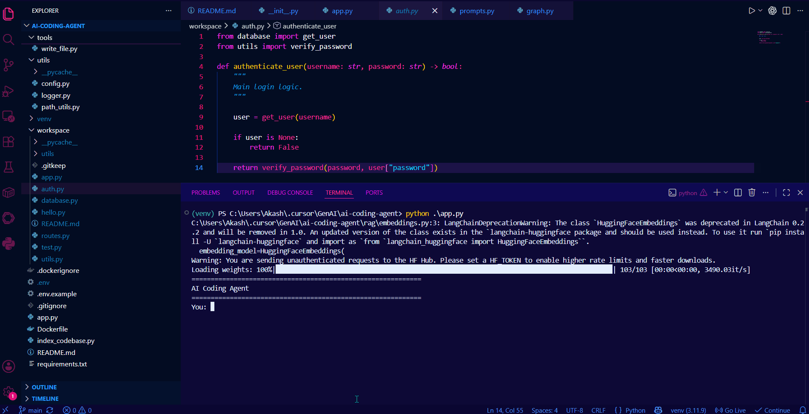

<!-- PROJECT BANNER -->

<p align="center">
  
</p>

<h1 align="center">🤖 AI Coding Agent</h1>

<p align="center">
An AI-powered coding assistant that understands, searches, edits, and debugs your codebase — built with <strong>LangGraph</strong>, <strong>Groq</strong>, <strong>RAG</strong>, <strong>FAISS</strong>, and <strong>Tree-sitter</strong>.
</p>

<p align="center">


</p>

---

## 📖 What is this?

This is an AI coding agent that goes beyond simple chat — it **plans**, **retrieves relevant code**, **calls tools**, and **generates informed responses** about any codebase you point it at.

Think of it as a mini Cursor/Copilot built from scratch to understand how modern AI coding assistants actually work under the hood.

### What it can do

- 📂 **Explore** an entire codebase and list files
- 🔍 **Search** code semantically using RAG + FAISS
- 📖 **Read & explain** source files
- 🧠 **Understand** code structure via AST parsing & Tree-sitter
- ✏️ **Create, edit, and delete** project files
- 💻 **Run** terminal commands
- 🐞 **Debug** runtime errors and tracebacks
- 🤖 **Plan** multi-step tasks before execution

---

## 🎬 Demo

<p align="center">

</p>

---

## 🏗️ Architecture

```text
                     User
                       │
                       ▼
                LangGraph Workflow
                       │
              ┌────────┴────────┐
              │                 │
         Planner Node      Chatbot Node
                                │
                         Tool Selection
                                │
      ┌──────────────┬──────────┼───────────────┐
      │              │          │               │
      ▼              ▼          ▼               ▼
 Code RAG      File Ops     Terminal      Code Structure
      │              │          │               │
      └──────────────┴──────────┴───────────────┘
                         │
                         ▼
                    Workspace
```

Every request flows through: **Plan → Retrieve Context → Select Tools → Execute → Respond**.

---

## 🛠️ Tools

| Tool | Purpose |
|------|---------|
| `retrieve_code` | Semantic code search via FAISS |
| `read_file` | Read file contents |
| `list_files` | List project files |
| `search_files` | Find files by name |
| `code_structure` | Extract functions, classes, imports |
| `run_terminal` | Execute shell commands |
| `debug_error` | Explain runtime errors |
| `create_file` | Create new files |
| `write_file` | Modify existing files |
| `delete_file` | Delete files |

---

## 📁 Project Structure

```text
ai-coding-agent/
├── agent/           # LangGraph workflow, nodes, planner, prompts
├── parser/          # AST & Tree-sitter code parsing
├── rag/             # Loader, chunker, embeddings, FAISS vector store
├── tools/           # All tool implementations
├── utils/           # Config, logger, path utilities
├── workspace/       # Sandboxed directory for target codebases
├── app.py           # Entry point
├── index_codebase.py
├── requirements.txt
├── Dockerfile
└── .env.example
```

---

## ⚡ Quick Start

### 1. Clone & install

```bash
git clone https://github.com/hridyansh2809/ai-coding-agent.git
cd ai-coding-agent
python -m venv venv
venv\Scripts\activate        # Windows
# source venv/bin/activate   # macOS/Linux
pip install -r requirements.txt
```

### 2. Configure

```bash
cp .env.example .env
```

Add your Groq API key to `.env`:

```env
GROQ_API_KEY=your_groq_api_key
MODEL_NAME=llama-3.3-70b-versatile
LOG_LEVEL=INFO
```

### 3. Index & run

Place your target project inside `workspace/`, then:

```bash
python index_codebase.py
python app.py
```

---

## 🐳 Docker

```bash
docker build -t ai-coding-agent .
docker run --env-file .env -it ai-coding-agent
```

---

## 💬 Example Prompts

```
Explain how authentication works.
Show the structure of workspace/app.py
Search for database-related files.
Create workspace/utils/math.py with an add() function.
Run pytest
Why am I getting this NameError?
```

---

## 🔑 Environment Variables

| Variable | Description | Required |
|----------|-------------|----------|
| `GROQ_API_KEY` | Groq API Key | ✅ |
| `MODEL_NAME` | Groq Model Name | ✅ |
| `LOG_LEVEL` | Logging Level | Optional |

---

## 🧠 Key Concepts

This project is a hands-on implementation of:

- **AI Agents** — autonomous tool-calling workflows
- **LangGraph** — graph-based orchestration for multi-step tasks
- **RAG** — retrieval-augmented generation for code search
- **FAISS** — vector similarity search over code embeddings
- **Tree-sitter & AST** — language-aware code parsing
- **Workspace sandboxing** — safe, isolated file operations

---

## 🚀 Future Ideas

- Git integration & incremental index updates
- Multi-language Tree-sitter support
- Streaming responses & web UI
- Patch-based editing instead of full file replacement
- Multi-agent collaboration

---

## ❓ Troubleshooting

| Problem | Fix |
|---------|-----|
| Groq API key not found | Add `GROQ_API_KEY` to your `.env` file |
| FAISS index missing | Run `python index_codebase.py` first |
| No files retrieved | Put your project inside `workspace/` before indexing |
| Docker build context too large | Ensure `.dockerignore` excludes `venv/`, `workspace/`, `faiss_index/`, `.git/` |

---

## 🤝 Contributing

Contributions welcome! Feel free to open issues, suggest features, or submit PRs.

---

## 📜 License

MIT License — free to use, modify, and distribute.

---

## 🙏 Acknowledgements

Built with [LangGraph](https://github.com/langchain-ai/langgraph), [LangChain](https://github.com/langchain-ai/langchain), [Groq](https://groq.com/), [FAISS](https://github.com/facebookresearch/faiss), [Sentence Transformers](https://www.sbert.net/), and [Tree-sitter](https://tree-sitter.github.io/).

---

## 👨‍💻 Author

**Hridyansh**

📎 [github.com/hridyansh2809](https://github.com/hridyansh2809)

---

<p align="center">
Built with ❤️ using Python, Groq, LangGraph, FAISS, and Tree-sitter.
</p>
